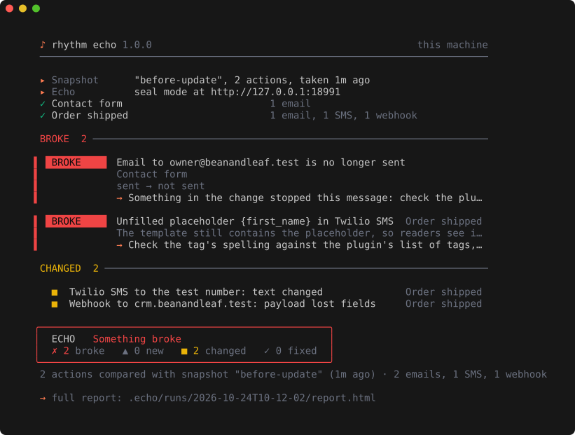

<p align="center">
  <picture>
    <source media="(prefers-color-scheme: dark)" srcset="docs/assets/banner-dark.svg">
    
  </picture>
</p>

<p align="center">
  <b>Is your site still saying what it should?</b><br>
  Echo captures every email, SMS, webhook and API call your site sends, seals staging so nothing reaches real people, and shows what each form, order or sign-up sends before and after a change. Built for PHP &amp; WordPress, with Laravel and Next.js connectors.
</p>

<p align="center">
  <a href="https://github.com/RhythmShahriar/echo/releases/latest"></a>
  <a href="https://github.com/RhythmShahriar/echo/actions/workflows/ci.yml"></a>
  <a href="LICENSE"></a>
  <a href="https://www.npmjs.com/package/@rhythmsh/echo"></a>
  <a href="https://packagist.org/packages/rhythmsh/echo-laravel"></a>
</p>

<p align="center">
  <a href="#install">Install</a> ·
  <a href="#seal-a-site">Seal a site</a> ·
  <a href="#check-a-change">Check a change</a> ·
  <a href="#what-it-catches">What it catches</a> ·
  <a href="https://github.com/RhythmShahriar/rhythm/wiki/Echo">Docs</a> ·
  <a href="https://github.com/RhythmShahriar/rhythm/wiki/Echo-Benchmark">Benchmark</a>
</p>

<br>

<p align="center">
  
</p>

<br>

## The Rhythm set

| | Asks | Checks |
|---|---|---|
| [Tuner](https://github.com/RhythmShahriar/tuner) | Is my site safe? | what an attacker can find |
| [Soundcheck](https://github.com/RhythmShahriar/soundcheck) | Did my change break anything? | what visitors see and do |
| **Echo** | **Is my site still saying what it should?** | **everything the site sends** |

## Install

```sh
curl -fsSL https://rythm.sh/install | sh               # macOS · Linux
irm https://rythm.sh/install.ps1 | iex                 # Windows (PowerShell)
go install github.com/RhythmShahriar/echo/cmd/rhythm-echo@latest
```

Every download is checked against the release checksums, which are [signed with cosign](https://github.com/RhythmShahriar/rhythm/wiki/Verifying-Releases).

`rhythm echo` and `rhythm-echo` are the same command: the `rhythm` CLI runs the `rhythm-echo` binary for you. Use either; the examples here use `rhythm echo`.

## Seal a site

Start Echo, then connect the site. Nothing the site sends leaves the machine; Echo answers in each service's place, so the site carries on as if the email went out and the SMS was delivered.

```sh
rhythm echo up                                   # API :8025 (live view), SMTP :1025
rhythm echo install wordpress /var/www/staging   # or: laravel, next, node, generic
rhythm echo doctor                               # canaries through every layer
rhythm echo watch                                # see each message as it's sent
```

| Stack | Connector | Catches |
|---|---|---|
| **WordPress** | one mu-plugin, written by `install` | every `wp_mail()` (beats FluentSMTP, Post SMTP), every `wp_remote_*()` call (SMS plugins, Woo webhooks, Slack, GA4, Meta CAPI, API mailers), and raw cURL SDKs through Echo's proxy |
| **Laravel** | `composer require rhythmsh/echo-laravel` | every mailer and transport, the `Http` client, Vonage and Slack notifications, queued jobs (the action follows them) |
| **Next.js · Node** | `npm i -D @rhythmsh/echo` + `instrumentation.ts` | `fetch` (Node and Edge), `http`/`https` (axios, SDKs), Nodemailer; built for Vercel previews too |
| **Anything** | SMTP, `sendmail_path`, `HTTPS_PROXY` | mail and outbound HTTPS from any language, through Echo's SMTP sink and MITM proxy |

Connectors switch themselves off in production. For a seal that can't be bypassed, run the app on an internal Docker network or behind a firewall with Echo as its only way out: [recipes](docs/seal).

## Check a change

List the actions that make your site send things in `.echo/config.yaml` (`rhythm echo init` writes examples): HTTP requests, WP-CLI or artisan commands, or signed webhook replays. Forms and multi-step journeys are driven by [Soundcheck](https://github.com/RhythmShahriar/soundcheck) with `--echo`.

```yaml
# .echo/config.yaml: ask WordPress for a password reset, which sends one email
site: https://staging.shop.test
actions:
  - name: Lost password
    http:
      method: POST
      url: /wp-login.php?action=lostpassword
      form: {user_login: admin}
    expect: {email: 1}
```

Each action counts as done when nothing new arrives for `quiet` (default 2s), or after `timeout` (default 30s). Echo caps `quiet` at 30s and `timeout` at 60s: a longer value acts as the cap.

> [!WARNING]
> **`.echo/config.yaml` is code.** A `command` action or a `flush` entry runs in your shell on every `snapshot`, `compare` and `run`. `${env:NAME}` puts an environment variable into an `http` action, which sends it to the URL the action names. Read a config from a repository you didn't write before you run Echo in it, as you would a Makefile.

```sh
rhythm echo snapshot --name before-update        # what each action sends now
# …update plugins, deploy…
rhythm echo compare --open                       # what changed, in a report
```

| Class | Means |
|---|---|
| **BROKE** | a message sent in the snapshot is missing now, fails, or has a new error (an unfilled `{first_name}`, a PHP warning in the email) |
| **NEW** | a message or a problem that wasn't there before |
| **CHANGED** | the same message, but different: recipient, subject, text, sender, fields of a payload |
| **FIXED** | a problem from the snapshot is gone |

| You want to… | Run |
|---|---|
| Check the contact form still emails the office | `rhythm soundcheck compare staging.shop.test --echo` |
| Replay a Stripe payment and see the order email | `rhythm echo replay payment_intent.succeeded --to /?wc-api=wc_stripe` |
| Check SPF, DKIM and DMARC for the sender you use | `rhythm echo check shop.com --from-mail received.eml` |
| Fail CI when a message stops being sent | `rhythm echo compare` (exits 1 on BROKE by default; `--fail-on new` is stricter) |
| Stream what the site sends into a script | `rhythm echo watch --json` (one JSON object per line) |

## What it catches

<table>
<tr>
<td width="50%" valign="top">

### 📭 Lost messages
The admin notification that stopped, the autoresponder a plugin update removed, the SMS a gateway change broke, the Slack alert, the GA4 purchase event, the queued mail stuck in a job, the webhook Zapier no longer receives.

</td>
<td width="50%" valign="top">

### ✍️ Wrong content
Unfilled placeholders (`{first_name}`, `*|FNAME|*`, `[your-name]`), PHP warnings printed into emails, links to staging or `localhost`, garbled encoding, emails too big for Gmail, SMS that cost three parts, payloads that lost fields.

</td>
</tr>
<tr>
<td valign="top">

### 🔒 Staging that talks to real people
Sealed by default: email, SMS, WhatsApp, webhooks, analytics and push are answered by Echo. Live-mode Stripe and PayPal calls get the provider's own refusal, so a test can't charge a card through either, even in observe mode. Other payment gateways are sealed like any other service, so in observe mode or on an allowlisted host they go through. In observe mode, any real recipient outside your allowlist is flagged.

</td>
<td valign="top">

### 📬 Deliverability
SPF (including the 10-lookup limit), DKIM keys, DMARC policy and alignment for the service you actually send through, MX, MTA-STS and TLS-RPT. `headers` reads a received email and tells you who sent it and why it passed or failed. Never sends anything.

</td>
</tr>
</table>

34 services are recognized out of the box, from SendGrid, Mailgun, Postmark, Resend and SES to Twilio, Vonage, WhatsApp Cloud, Slack, Teams, GA4, Meta, FCM, Stripe, HubSpot, Klaviyo and Zapier. Anything else is captured as a generic webhook.

## Why Echo

- **Compares, not just catches.** Mail catchers show you an inbox. Echo tells you what changed in what your site sends, ranked, after every update.
- **Every channel.** Email, SMS, WhatsApp, chat, webhooks, analytics, push and payment calls, in one place.
- **No test code.** Actions are a few lines of YAML; Soundcheck drives real forms; replay sends signed webhooks.
- **Local and free.** One binary, your machine or your CI. Captured messages stay on your machine, with credentials masked before they're stored.

## CI

```yaml
- uses: RhythmShahriar/echo@v1
  with:
    mode: compare
    fail-on: broke
```

Or start Echo for Soundcheck: `mode: up`, then `rhythm soundcheck compare … --echo`. More in the [CI guide](https://github.com/RhythmShahriar/rhythm/wiki/Echo-CI).

## Docs

| | |
|---|---|
| [Your first run](https://github.com/RhythmShahriar/rhythm/wiki/Echo-First-Run) | seal a site and check a change, in ten minutes |
| [Connectors](https://github.com/RhythmShahriar/rhythm/wiki/Echo-Install-Connectors) | WordPress, Laravel, Next.js, Node, anything |
| [Sealing staging](https://github.com/RhythmShahriar/rhythm/wiki/Echo-Sealing-Staging) | what's caught, what's faked, hard seals |
| [Actions and compare](https://github.com/RhythmShahriar/rhythm/wiki/Echo-Actions-And-Compare) | `.echo/config.yaml`, snapshots, classes |
| [With Soundcheck](https://github.com/RhythmShahriar/rhythm/wiki/Echo-With-Soundcheck) | forms and flows, with their messages |
| [CLI reference](https://github.com/RhythmShahriar/rhythm/wiki/Echo-CLI-Reference) | every command, flag and exit code |

All of it lives in the **[Rhythm documentation wiki](https://github.com/RhythmShahriar/rhythm/wiki)**.

## Contributing

```sh
git clone https://github.com/RhythmShahriar/echo && cd echo
make hooks   # Conventional Commits check
make check   # lint + tests
```

The connectors have their own tests: `make -C connectors/laravel check` (Docker), `cd connectors/node && npm test`. See [CONTRIBUTING](https://github.com/RhythmShahriar/.github/blob/master/CONTRIBUTING.md).

## Responsible use & disclaimer

Echo is built to help people **test their own sites safely**.

- **Use it only on sites you own or are authorized to test.** Replays and actions send real requests to the site you point them at.
- **Captured messages contain personal data.** They stay on your machine (or CI runner); credentials are masked, content isn't. Treat `.echo/` like a database dump, and use test data on staging.
- **Observe mode really sends.** Seal is the default for a reason; use observe only where real delivery is safe.
- **No warranty.** Echo is provided "as is", as set out in the [license](LICENSE). A connector can miss a message sent in a way it doesn't hook; use a hard seal where a leak would matter.

Found a vulnerability in Echo itself? Please [report it privately](https://github.com/RhythmShahriar/echo/security/advisories/new).

## License

[MIT](LICENSE).

<p align="center"><sub>Part of <a href="https://github.com/RhythmShahriar/rhythm"><b>rhythm</b></a> · Useful ideas. Working systems.</sub></p>
